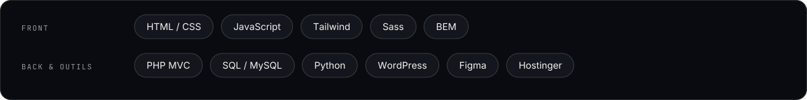

  

  
  
  
  
  

Je conçois et développe des sites vitrines, des web apps et des refontes sur mesure, du front à l'hébergement. Basé à Châteauroux et Limoges, je travaille aussi à distance partout en France.

 

I design and build custom showcase sites, web apps and redesigns, from front end to hosting. Based in Châteauroux and Limoges, France, and available for remote work anywhere in the country.

#### Services

- Showcase sites with an admin panel, so you can manage your content yourself
- Custom web apps in PHP
- Redesign of existing sites

#### Projects

1. Barcelona Feel Good Tours, a client project: a multilingual PHP MVC showcase site with a CRUD admin panel, built with HTML5, Tailwind, PHP and MySQL and hosted on Hostinger. [Website](https://barcelonafeelgoodtours.eu/) · [Source](https://github.com/YannLf3/Perso_Barcelona-guide)
2. My portfolio: PHP 8 MVC, MySQL through PDO, an admin back-office, light and dark themes and two modes, developer and photographer. [Website](https://yannleflohic.fr/) · [Source](https://github.com/YannLf3/Portoflio)
3. A fictional WordPress landing page built for a course project. [Source](https://github.com/YannLf3/SAE202_Wordpress)

#### Contact

Tell me about your project in a few lines and I'll get back to you at [yann.lfhc@icloud.com](mailto:yann.lfhc@icloud.com), or find me on [Malt](https://www.malt.fr/profile/yannleflohic1) and [LinkedIn](https://www.linkedin.com/in/yannlf3/).

 

 

 

 

 

 

## Services

- Sites vitrines avec back-office pour gérer son contenu en autonomie
- Web apps sur mesure en PHP
- Refonte de sites existants

## Projets

 

- Site vitrine multilingue en PHP MVC, avec une administration CRUD pour gérer le contenu sans toucher au code.
- Né d'un projet de première année de BUT MMI, aujourd'hui en ligne sur le domaine du client.
- HTML5, TailwindCSS, PHP et MySQL, hébergé chez Hostinger.
- [Voir le site](https://barcelonafeelgoodtours.eu/) · [Code source](https://github.com/YannLf3/Perso_Barcelona-guide)

 

- PHP 8 en architecture MVC, MySQL via PDO, requêtes préparées et sessions sécurisées pour l'administration.
- Interface en Tailwind CSS et JavaScript, avec thème clair et sombre, et deux modes (développeur et photographe) qui changent la couleur d'accent et le contenu de la page.
- Hébergé chez Hostinger.
- [Voir le site](https://yannleflohic.fr/) · [Code source](https://github.com/YannLf3/Portoflio)

 

- Landing page fictive sous WordPress, réalisée en SAÉ 2.02 du BUT MMI.
- [Code source](https://github.com/YannLf3/SAE202_Wordpress)

## Contributions

  <picture>
    <source media="(prefers-color-scheme: dark)" srcset="https://raw.githubusercontent.com/YannLf3/YannLf3/output/github-contribution-grid-snake-dark.svg">
    <source media="(prefers-color-scheme: light)" srcset="https://raw.githubusercontent.com/YannLf3/YannLf3/output/github-contribution-grid-snake.svg">
    
  </picture>

## Stack

## Contact

Un projet en tête ? Décrivez-moi votre besoin en quelques lignes, je reviens vers vous.

  
  
  

